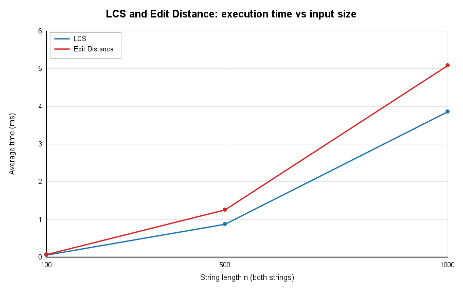
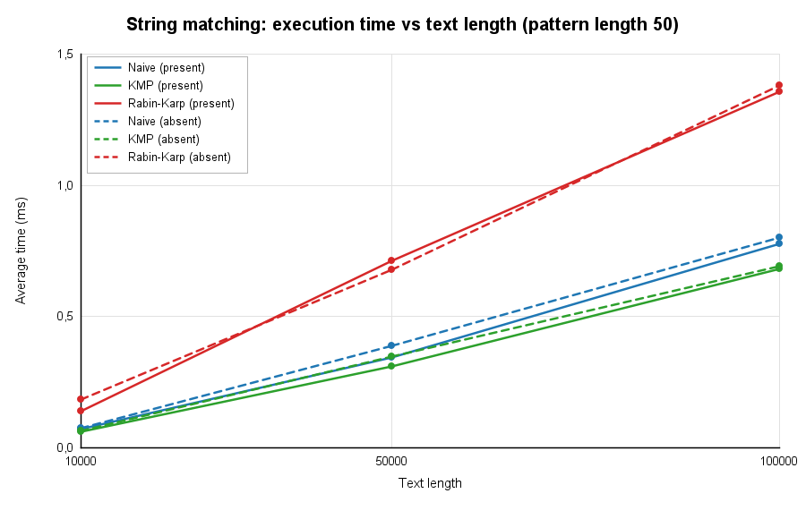
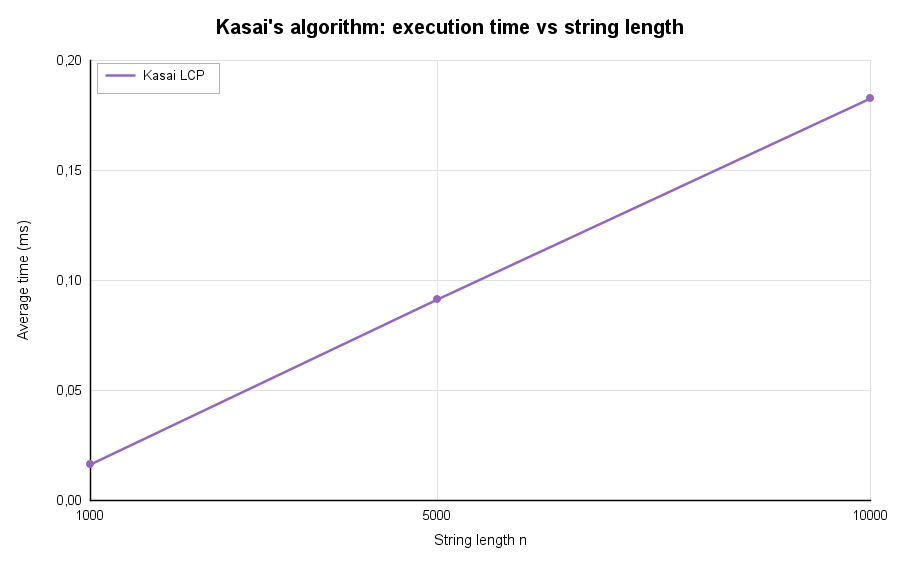

# Assignment 4: Text Analysis, Dynamic Programming and String Algorithms

Java application implementing LCS, Edit Distance, Naive / KMP / Rabin-Karp string matching and Kasai's LCP algorithm, with tests, an experimental evaluation and a complexity analysis. All algorithms are implemented by hand (no library replacements). This README is the full report.

## Contents
1. [Problem description and algorithm overview](#1-problem-description-and-algorithm-overview)
2. [Implementation decisions and assumptions](#2-implementation-decisions-and-assumptions)
3. [Complexity analysis](#3-complexity-analysis)
4. [Testing strategy and results](#4-testing-strategy-and-results)
5. [Experimental setup and timing methodology](#5-experimental-setup-and-timing-methodology)
6. [Results: tables and plots](#6-results-tables-and-plots)
7. [Discussion: theory versus experiment](#7-discussion-theory-versus-experiment)
8. [Conclusion](#8-conclusion)

## 1. Problem description and algorithm overview

Notation: `m`, `n` are string/text lengths (`m` is also the pattern length in string matching; this is stated explicitly where it matters).

### Part A: Dynamic programming

**LCS** finds the length of the longest subsequence (characters in order, not necessarily contiguous) shared by strings `a` (length m) and `b` (length n).

- Table: `dp[i][j]` = LCS length of the prefixes `a[0..i)` and `b[0..j)`.
- Base cases: `dp[0][j] = dp[i][0] = 0` (an empty prefix has no common subsequence with anything).
- Recurrence: if `a[i-1] == b[j-1]` then `dp[i][j] = dp[i-1][j-1] + 1`, otherwise `dp[i][j] = max(dp[i-1][j], dp[i][j-1])`.
- Answer: `dp[m][n]`. File: `src/dp/LCS.java`.

*Why it is correct.* Consider the last characters of the two prefixes. If they are equal, some optimal common subsequence can always use both of them as its last character (matching them can never be worse than leaving either unmatched), so the answer is 1 plus the LCS of the prefixes without those characters. If they differ, they cannot both be the last character of a common subsequence, so at least one of them is not used: the optimum is the better of dropping the last character of `a` or of `b`. Every subproblem is a pair of prefixes, there are `(m+1)(n+1)` of them, and each depends only on smaller prefixes, so filling the table row by row evaluates every subproblem after the ones it depends on (optimal substructure + overlapping subproblems).

**Edit Distance (Levenshtein)** is the minimum number of insertions, deletions and substitutions (each cost 1) needed to turn `a` into `b`.

- Table: `dp[i][j]` = edit distance between `a[0..i)` and `b[0..j)`.
- Base cases: `dp[i][0] = i` (delete all i characters), `dp[0][j] = j` (insert all j characters).
- Recurrence: `dp[i][j] = min( dp[i-1][j] + 1, dp[i][j-1] + 1, dp[i-1][j-1] + (a[i-1] == b[j-1] ? 0 : 1) )`.
- Answer: `dp[m][n]`. File: `src/dp/EditDistance.java`.

*Why it is correct.* Look at the last operation of an optimal edit script for the two prefixes. It is either a deletion of `a[i-1]` (cost 1 plus the distance from `a[0..i-1)` to `b[0..j)`), an insertion of `b[j-1]` (cost 1 plus the distance from `a[0..i)` to `b[0..j-1)`), or the last characters are aligned: free if equal, a substitution (cost 1) if different, plus the distance of the two shorter prefixes. These three cases cover all possibilities and the cheapest one is taken. Base cases follow because transforming to or from an empty string needs exactly that many insertions or deletions.

### Part B: String matching

All three algorithms return every starting index (ascending, overlapping matches included) where the pattern occurs in the text. Files: `src/matching/NaiveMatcher.java`, `KMPMatcher.java`, `RabinKarpMatcher.java`, common interface `StringMatcher.java`.

- **Naive**: tries each of the `n-m+1` alignments and compares left to right until the first mismatch. It is the baseline.
- **Knuth-Morris-Pratt (KMP)**: preprocesses the pattern into the LPS (prefix) table, where `lps[i]` is the length of the longest proper prefix of `pattern[0..i]` that is also a suffix of it.
  *How KMP avoids repeated comparisons.* When a mismatch happens after `j` characters matched, the last `j` text characters are known to equal `pattern[0..j)`. The longest border of that prefix is `lps[j-1]`, so the pattern can be shifted so that the first `lps[j-1]` characters are already known to match, and comparison resumes from there. The text index `i` never moves backwards, so each text character is examined a bounded number of times (every iteration either advances `i` or decreases `j`, and `j` can only decrease as often as it was increased), giving at most `2n` comparisons.
- **Rabin-Karp**: compares hash values of the pattern and of each text window of length `m`. Hash: `h(s[i..i+m)) = (s[i]·B^(m-1) + ... + s[i+m-1]) mod M` with `B = 256`, `M = 1,000,000,007`. The next window's hash is computed in O(1) from the previous one by removing the leading character's contribution, multiplying by `B` and adding the new character.
  *How Rabin-Karp handles hash collisions.* Different strings can have equal hashes. Therefore, equal hashes are only a candidate: every hash match is verified by comparing the window with the pattern character by character, and an index is reported only if all `m` characters match. A failed verification is counted as a "spurious hit". Collisions therefore cost time but never cause a wrong answer (a unit test forces many collisions with a tiny modulus to show this).

### Part C: Kasai's LCP algorithm

Files: `src/suffix/Kasai.java` (algorithm), `src/suffix/SuffixArray.java` (simple suffix array builder used only to provide Kasai's input).

**What the LCP array represents.** For a string `s` and its suffix array `sa` (the start indices of all suffixes in lexicographic order), `lcp[i]` is the length of the longest common prefix of the suffixes `s[sa[i-1]..]` and `s[sa[i]..]`, i.e. of two neighbours in sorted order; `lcp[0] = 0` by convention. It tells how much adjacent suffixes share, which is used for example to find repeated substrings (the longest repeated substring has length `max(lcp)`) and to count distinct substrings.

**Algorithm.** Compute `rank[sa[i]] = i`. Process suffixes in text order `i = 0..n-1`: let `j = sa[rank[i]-1]` be the suffix before `i` in sorted order and extend `h` while `s[i+h] == s[j+h]`; store `lcp[rank[i]] = h`; then decrease `h` by 1 (if positive) and go to `i+1`.
The key fact: if suffix `i` shares `h > 0` characters with its sorted predecessor, then suffix `i+1` shares at least `h-1` characters with *its* predecessor (drop the first character from both suffixes), so the scan can resume from `h-1` instead of 0.

## 2. Implementation decisions and assumptions

- **Language / build**: Java 17+, no external libraries. Tests use a small dependency-free runner (`AllTests`) instead of JUnit so the project compiles with plain `javac`.
- **Project structure**
  ```
  src/
      dp/            LCS.java, EditDistance.java
      matching/      StringMatcher.java, NaiveMatcher.java, KMPMatcher.java, RabinKarpMatcher.java
      suffix/        Kasai.java, SuffixArray.java
      experiments/   Experiments.java (all benchmarks), Plotter.java (PNG charts)
  test/              AllTests.java
  results/           CSV files, tables.md, test_output.txt (generated)
  plots/             PNG plots (generated)
  README.md
  ```
- **LCS** returns the *length* (as the assignment states), using the full `(m+1)×(n+1)` table.
- **Empty pattern assumption**: an empty pattern is defined to have **no occurrences**, so all three algorithms return an empty list. A pattern longer than the text also returns an empty list. This is applied identically in Naive, KMP and Rabin-Karp, and it is covered by tests.
- Matching is case-sensitive and works on Java `char`s. Occurrences may overlap (e.g. `aa` in `aaaaa` is found at 0, 1, 2, 3).
- **Rabin-Karp**: base 256, modulus 1,000,000,007 (`long` arithmetic, no overflow), every hash match verified character by character. The constructor `RabinKarpMatcher(long mod)` exists only so a test can force collisions.
- **Operation counts** (character comparisons): Naive counts every text/pattern comparison. KMP counts comparisons in both the LPS construction and the search. Rabin-Karp counts only the comparisons made while verifying hash matches (rolling-hash arithmetic is not a comparison) and additionally reports spurious hits. Kasai counts every `s[i+h] == s[j+h]` evaluation. For LCS and Edit Distance the number of table cells (and character comparisons) is exactly `m·n`, reported in the table. Counters are plain `long` increments that are part of the algorithms and therefore also part of the timed region.
- **Kasai input**: `SuffixArray.build` sorts suffix indices with a simple comparator (O(n² log n) worst case), allowed by the assignment. It is **not timed**. For the manual test the suffix array of `banana` is given directly as a verified constant.
- **Conventions**: `lcp[0] = 0`; `lcp[i]` compares `sa[i-1]` and `sa[i]`.

### Build and run

Requires a JDK (Java 17 or newer). Run all commands from the repository root, because results and plots are written to `results/` and `plots/` relative to the working directory.

```bash
# Linux / macOS
mkdir -p out
javac -d out $(find src test -name "*.java")

# Windows (cmd)
mkdir out
dir /s /b src\*.java test\*.java > sources.txt
javac -d out @sources.txt

# Run the tests (exit code 1 if any test fails)
java -cp out AllTests

# Run all experiments; writes results/*.csv, results/tables.md and plots/*.png
java -cp out experiments.Experiments
```

In IntelliJ IDEA: mark `src` as *Sources Root* and `test` as *Test Sources Root*, run `main` in `AllTests` and in `Experiments`, and set the run configuration's *Working directory* to the project root.

## 3. Complexity analysis

`n` = text/string length, `m` = pattern length (string matching) or length of the second string (DP). Auxiliary space excludes the returned occurrence list.

| Algorithm | Main operation / recurrence | Best-case time | Worst-case time | Auxiliary space | Justification |
|---|---|---|---|---|---|
| LCS | `dp[i][j] = dp[i-1][j-1]+1` if chars equal, else `max(dp[i-1][j], dp[i][j-1])` | Θ(mn) | Θ(mn) | Θ(mn) | Every one of the `(m+1)(n+1)` cells is computed once in O(1), independent of the input content. The whole table is stored. |
| Edit Distance | `dp[i][j] = min(dp[i-1][j]+1, dp[i][j-1]+1, dp[i-1][j-1]+cost)` | Θ(mn) | Θ(mn) | Θ(mn) | Same table structure: `(m+1)(n+1)` cells, O(1) each, full table kept. |
| Naive matching | Compare pattern with text at each of the `n-m+1` alignments | O(n) (first character mismatches at every alignment, e.g. text `aaaa…`, pattern `b…`) | O(nm) (e.g. text `aaaa…a`, pattern `aaa…ab`) | O(1) | Each alignment costs between 1 and `m` comparisons. |
| KMP | LPS table; on mismatch `j = lps[j-1]`, text index never decreases | O(n + m) | O(n + m) | O(m) | Preprocessing is O(m) by the same amortized argument as the search. In the search every iteration advances `i` or strictly decreases `j`; `j` rises only when `i` advances, so there are at most `2n` iterations. The LPS table has `m` entries. |
| Rabin-Karp | Rolling hash `h' = ((h − s[i]·B^(m-1))·B + s[i+m]) mod M`, verify on hash match | O(n + m) | O(nm) | O(1) | Hashing the pattern and first window is O(m); each roll is O(1), so `n-m+1` windows cost O(n). Verification costs O(m) per hash match. With a good hash, spurious matches are rare, so the *expected* time is O(n + m) (plus O(m) per true occurrence). The *worst case* O(nm) occurs when many windows have the same hash as the pattern (adversarial input or a very poor hash), or when the text contains the pattern at nearly every position (e.g. `aaaa…`), which costs `m` per genuine match. |
| Kasai (LCP) | Scan suffixes in text order, extend `h`, then `h = max(h-1, 0)` | O(n) | O(n) | O(n) | `h` starts at 0, increases by 1 per successful character comparison and decreases by at most 1 per outer iteration, so it increases at most `n + (number of decreases) ≤ 2n` times in total; failed comparisons occur at most once per outer iteration. Total O(n). Needs `rank` and `lcp` arrays of size `n` (the given suffix array is input). |

**Theory versus measurement.** The table above is *asymptotic* (growth rate of the operation count in the best or worst case). Section 6 reports *measured* wall-clock time on specific random inputs on one machine. Measured times depend on the hardware, the JIT compiler, caches and garbage collection, and random inputs are neither best nor worst cases. Therefore, measured results can confirm growth trends but not the constants or worst-case bounds. For Rabin-Karp the *expected* bound O(n+m) is the one relevant to random data, while the O(nm) *worst case* needs adversarial input not used in the fixed workloads.

## 4. Testing strategy and results

Tests are in `test/AllTests.java` and are run with `java -cp out AllTests`. Every string-matching test runs Naive, KMP and Rabin-Karp and requires **each of them** to return exactly the expected list of indices, so the three results are also equal to each other.

| Area | Cases tested |
|---|---|
| LCS | identical strings, completely different strings, an empty string (first, second, both), one general case (`ABCBDAB`/`BDCABA` = 4) |
| Edit Distance | identical strings, one empty string (both directions), substitution (`cat`→`cut`), insertion (`cat`→`cart`), deletion (`cart`→`cat`), one general case (`kitten`→`sitting` = 3) |
| String matching | pattern at the beginning, in the middle, at the end; multiple occurrences; overlapping occurrences; pattern absent; pattern longer than the text; empty pattern (assumption: no occurrences); empty text; Rabin-Karp with a tiny modulus (5) that forces hash collisions, checking the result still equals Naive's and that spurious hits did occur |
| Kasai | `banana`: suffix array `[5, 3, 1, 0, 4, 2]` and expected LCP `[0, 1, 3, 0, 0, 2]` |

**Manual verification of the Kasai test.** The sorted suffixes of `banana` are: `a` (5), `ana` (3), `anana` (1), `banana` (0), `na` (4), `nana` (2). The LCP of each suffix with its predecessor: `a`/`ana` = 1, `ana`/`anana` = 3, `anana`/`banana` = 0, `banana`/`na` = 0, `na`/`nana` = 2, giving `[0, 1, 3, 0, 0, 2]`. The test passes the manually written suffix array to Kasai and compares with this array (and additionally checks that `SuffixArray.build` produces the same suffix array).

**Result:** all 44 checks pass (`Passed: 44, Failed: 0`); the full output is stored in `results/test_output.txt`.

## 5. Experimental setup and timing methodology

- **Environment of the reported run**: Windows, JDK 21, CPU: `<fill in your CPU model, cores>`, RAM: `<fill in>`. Times will differ on other machines; rerun the experiments to reproduce the numbers on your own hardware.
- **Alphabet**: `{a, b, c, d}` (|Σ| = 4) for all random strings and texts.
- **Random seed**: `java.util.Random` with the fixed seed 42 (derived seeds `42 + n` for the text of length `n`, `42 + 7` for the absent pattern), so every run generates identical inputs.
- **Workloads (as specified)**

  | Experiment | Input sizes |
    |---|---|
  | LCS | two random strings of length 100, 500, 1,000 |
  | Edit Distance | the same two strings as LCS at each size |
  | String matching | text lengths 10,000, 50,000, 100,000; pattern length 50 |
  | Kasai's algorithm | strings of length 1,000, 5,000, 10,000 |

- **String-matching patterns**: *present* = the substring of the text at positions `[n/2, n/2+50)` (always occurs at least once); *absent* = a random pattern of length 50 re-generated until Naive confirms that it does not occur. For each text length and each case, the **same text and the same pattern** are given to Naive, KMP and Rabin-Karp, and the program checks (outside the timed region) that all three return identical index lists.
- **Timing**: `System.nanoTime()` is read immediately before and after the single call of the algorithm (`LCS.length`, `EditDistance.distance`, `matcher.search`, `Kasai.build`). Each experiment is timed **5 times and the average is reported** in milliseconds. Input generation, suffix array construction, result checking, console output and file writing are outside the timed regions (output is written after all timing is finished).
- **JIT warm-up**: before the 5 timed runs, each task is run untimed for at least 30 runs and 300 ms so that the JVM's JIT compilation does not distort the first measurements; these warm-up runs are not part of the reported averages. Results are consumed into a `volatile` sink so the work cannot be optimized away.
- **Operation counts**: character comparisons as described in section 2, taken from one search/build on the same input.

## 6. Results: tables and plots

All numbers below were produced by `experiments.Experiments` (raw data: `results/dp_results.csv`, `results/matching_results.csv`, `results/kasai_results.csv`, tables: `results/tables.md`). Times are averages of 5 runs in milliseconds.

### LCS and Edit Distance (average of 5 runs)

| Length n (both strings) | LCS time (ms) | Edit Distance time (ms) | DP cells computed (n*n) | LCS length | Edit distance |
|---:|---:|---:|---:|---:|---:|
| 100 | 0.0550 | 0.0707 | 10000 | 64 | 55 |
| 500 | 0.8688 | 1.2490 | 250000 | 326 | 267 |
| 1000 | 3.8618 | 5.0802 | 1000000 | 648 | 521 |

### String matching, pattern present (pattern length 50, average of 5 runs)

| Text length | Occurrences | Naive time (ms) | KMP time (ms) | Rabin-Karp time (ms) | Naive comparisons | KMP comparisons | Rabin-Karp comparisons | Rabin-Karp spurious hits |
|---:|---:|---:|---:|---:|---:|---:|---:|---:|
| 10000 | 1 | 0.0732 | 0.0623 | 0.1392 | 13408 | 12559 | 50 | 0 |
| 50000 | 1 | 0.3432 | 0.3110 | 0.7115 | 66662 | 61861 | 50 | 0 |
| 100000 | 1 | 0.7779 | 0.6812 | 1.3562 | 132907 | 124726 | 50 | 0 |

### String matching, pattern absent (pattern length 50, average of 5 runs)

| Text length | Occurrences | Naive time (ms) | KMP time (ms) | Rabin-Karp time (ms) | Naive comparisons | KMP comparisons | Rabin-Karp comparisons | Rabin-Karp spurious hits |
|---:|---:|---:|---:|---:|---:|---:|---:|---:|
| 10000 | 0 | 0.0741 | 0.0650 | 0.1827 | 13388 | 12604 | 0 | 0 |
| 50000 | 0 | 0.3887 | 0.3476 | 0.6769 | 66438 | 62470 | 0 | 0 |
| 100000 | 0 | 0.8001 | 0.6905 | 1.3790 | 132683 | 124736 | 0 | 0 |

### Kasai's algorithm (average of 5 runs, suffix array construction not timed)

| String length n | Time (ms) | Character comparisons |
|---:|---:|---:|
| 1000 | 0.0165 | 1990 |
| 5000 | 0.0915 | 9991 |
| 10000 | 0.1827 | 19989 |

### Plots

**Plot 1: LCS and Edit Distance, execution time vs input size** (`plots/dp_time_vs_size.png`)



**Plot 2: Naive, KMP and Rabin-Karp, execution time vs text length** (`plots/matching_time_vs_text_length.png`; solid lines = pattern present, dashed lines = pattern absent)



**Additional plot: Kasai's algorithm, execution time vs string length** (`plots/kasai_time_vs_size.png`)



## 7. Discussion: theory versus experiment

Timings below 1 ms are close to the range where JVM, cache and operating-system noise matter, so growth ratios are approximate.

**LCS and Edit Distance (theory: Θ(mn), so quadratic when both strings grow).** Going from n = 500 to n = 1,000 multiplies the number of table cells by 4. The measured time grew by about 4.4× for LCS (0.869 ms to 3.862 ms) and 4.1× for Edit Distance (1.249 ms to 5.080 ms), which is consistent with quadratic growth. From n = 100 to 500 the cell count grows 25×, while the measured growth was about 16× (LCS) and 18× (Edit Distance); the n = 100 measurement (about 0.06 ms) is so small that fixed overheads such as allocating the table and cache effects distort the ratio. Edit Distance was slower than LCS at every size (about 1.3× at n = 1,000 and 1.4× at n = 500) even though both fill the same number of cells; this is a constant-factor difference (two extra `min` operations per cell and the initialization of the first row and column), not a different growth rate, which matches the identical Θ(mn) bound in the table. Both use Θ(mn) memory (a 1,001 × 1,001 `int` table is about 4 MB), which is the practical limit of this implementation.

**String matching (theory: Naive O(nm) worst case, KMP O(n+m), Rabin-Karp expected O(n+m)).** All three algorithms scale roughly linearly with the text length: from 10,000 to 100,000 characters (10× more text) the time for the present pattern grew by about 10.6× (Naive), 10.9× (KMP) and 9.7× (Rabin-Karp). The operation counts show why Naive does not look quadratic here: on a random text over a 4-letter alphabet a wrong alignment is usually rejected after the first or second comparison, so Naive made about 1.33n comparisons (132,907 for n = 100,000, matching the expected 4/3·n for |Σ| = 4), and KMP about 1.25n (124,726), always below its bound of 2n. Therefore, on this data KMP saves only about 6% of the comparisons. KMP was also measurably, but modestly, faster in time (0.681 ms versus 0.778 ms for the present pattern and 0.691 ms versus 0.800 ms for the absent pattern at n = 100,000, roughly 12 to 14% less). The advantage of KMP is the *guaranteed* O(n+m) bound; the O(nm) worst case of Naive (for example text `aaa…a`, pattern `aaa…ab`) is not triggered by random text, so it is **not** visible in these measurements and is supported only by the theoretical analysis. Present and absent patterns gave almost the same times because the dominant cost is scanning the whole text in both cases; the small differences at n = 10,000 (for example Rabin-Karp 0.139 ms present versus 0.183 ms absent, although the work is nearly identical) are measurement noise.

Rabin-Karp was the slowest in measured time (about 1.7× slower than Naive at n = 100,000) even though it made the fewest character comparisons (50 for the present pattern, which is exactly one verification of a true match, and 0 for the absent pattern, with 0 spurious hits in both cases). This shows that the number of character comparisons is not the same as running time: Rabin-Karp performs a rolling-hash update with multiplications and modulo operations for every window, a larger constant cost per text position than a single character comparison. Its expected O(n+m) behaviour is confirmed by the linear growth and by the absence of spurious hits with M = 1,000,000,007; its O(nm) worst case, which needs many hash matches, did not occur.

**Kasai (theory: O(n)).** The number of character comparisons was 1,990, 9,991 and 19,989 for n = 1,000, 5,000 and 10,000, i.e. about 2n, which matches the amortized bound derived in section 3 (at most about 2n comparisons) almost exactly. Measured time grew from 0.0165 ms to 0.0915 ms and 0.1827 ms: 10× more data cost about 11× more time, and doubling from 5,000 to 10,000 doubled the time (2.0×). This is linear growth, not quadratic.

**Theory versus experiment in general.** The experiments agree with the asymptotic analysis for the growth rate (quadratic DP, linear matching, linear Kasai) and show where constant factors matter (Edit Distance versus LCS, Rabin-Karp's hashing cost). They cannot show worst-case behaviour of Naive or Rabin-Karp, because random inputs are close to the average case, and they cannot prove an asymptotic bound, because only three input sizes were measured.

## 8. Conclusion

- **LCS and Edit Distance** share the same Θ(mn) time and Θ(mn) space table-filling structure; the recurrences differ only in how mismatches are handled (LCS skips a character, Edit Distance pays a unit cost). The trade-off of dynamic programming is polynomial time that is independent of the input content, paid for with memory proportional to the table size.
- **Naive matching** is the simplest, needs no preprocessing and O(1) extra space, and is fast on random text, but has an O(nm) worst case.
- **KMP** gives a guaranteed O(n+m) running time for any input at the cost of O(m) extra space and the more subtle LPS preprocessing; on random text its advantage over Naive was small (about 1.25n versus 1.33n comparisons, and about 12 to 14% less time).
- **Rabin-Karp** has expected O(n+m) time with O(1) space and needs very few character comparisons, but the rolling hash makes each position more expensive (it was the slowest in measured time here), it relies on a good hash to avoid the O(nm) worst case, and every hash match must be verified. It is attractive mainly for searching many patterns at once, which this assignment does not test.
- **Kasai's algorithm** builds the LCP array in O(n) time and O(n) space from a given suffix array, using the amortized "h decreases by at most 1" argument; measured comparisons were about 2n. The expensive part of the suffix-array pipeline is constructing the suffix array itself, which was done with a simple method and was excluded from the timings.

In short, the main trade-offs are guaranteed worst-case time (KMP, Kasai) versus simplicity (Naive) versus low memory and expected-case speed through hashing (Rabin-Karp), and, for dynamic programming, polynomial time in exchange for quadratic memory.
